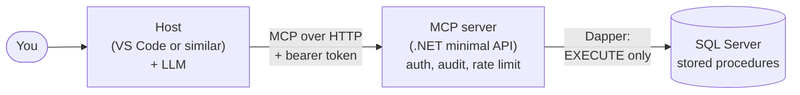

# Secure, read-only MCP server for SQL Server (C# / .NET)

This project lets an AI assistant (e.g. a local or cloud based LLM) query a SQL Server database **without being able to change the database or any of the underlying data**.

- An ASP.NET Core minimal API hosts the MCP server.
- The server calls stored procedures through Dapper.
- The database login has only the permissions required to run those stored procedures.
- Local development uses named bearer tokens; production can use Microsoft Entra ID.
- Secrets are kept out of source control. Local development uses .NET user-secrets and Docker's ignored `.env` file.

> **All data is synthetic.** Companies, clients, and prices are invented. This project is for educational purposes only and is not production-ready.

## Architecture



The model decides which tool to call; the host makes the call and returns the result. The server only runs stored procedures, with a database login that has no table permissions.

## Videos

| # | Video |
|---|-------|
| 1 | Introduction and local demo |
| 2 | Set up SQL Server with Docker and load the sample data |
| 3 | Run the MCP server and ask questions from VS Code |

Video links will be added as episodes are published. Azure deployment and using a local LLM are optional follow-up topics.

## Prerequisites

- [.NET SDK 10](https://dotnet.microsoft.com/download)
- [Docker Desktop](https://www.docker.com/products/docker-desktop/) (on Windows, use the default WSL 2 backend)
- [Node.js and npm](https://nodejs.org/) (for MCP Inspector; testing MCP server only)
- [VS Code](https://code.visualstudio.com/) and GitHub Copilot Chat (for the VS Code guide)
- [Git](https://git-scm.com/)
- An Azure account, only for the optional deployment guide

## Get the code

```sh
git clone https://github.com/Code-Express-AI/trading-mcp-dotnet.git
cd trading-mcp-dotnet
```

## Quick start guides

Follow the first three guides in order for the complete local walkthrough. The commands work on Windows (PowerShell), macOS, and Linux. Where a step differs, the guide shows both versions.

1. [Start SQL Server and load the synthetic trading data](docs/01-docker-database.md)
2. [Run the MCP server and test it with MCP Inspector](docs/02-run-server-and-inspector.md)
3. [Connect VS Code and Copilot, then ask questions](docs/03-vscode-copilot.md)
4. Optional: [Deploy the database and MCP server to Azure](docs/04-azure-deployment.md)
5. Optional: [Use a local LLM from VS Code](docs/05-local-llm.md)

## Tests and coverage

The `XTests` project has two kinds of test:

- **Unit tests** check the logic on its own: option parsing, data generation, tool argument checks, authentication and auditing. They need nothing installed and run in under a second.
- **Integration tests** run against the local Docker SQL Server. They load data into a throwaway database, call every stored procedure as `mcp_reader`, and prove that `mcp_reader` can't read or change the tables directly and that nobody, not even `sa`, can change the audit log. If SQL Server isn't running, they're skipped rather than failed.

Run all the tests:

```sh
dotnet test XTests/XTests.csproj
```

Run only the unit tests:

```sh
dotnet test XTests/XTests.csproj --filter 'Category!=Integration'
```

Run only the integration tests. Start SQL Server and load the data first (guide 1):

```sh
dotnet test XTests/XTests.csproj --filter 'Category=Integration'
```

Run all the tests with coverage collection:

```sh
dotnet test XTests/XTests.csproj --collect:"XPlat Code Coverage"
```

In VS Code, the `XTests: Run tests with coverage` task runs the same command. To view coverage in the editor, install the recommended Coverage Gutters extension and run **Coverage Gutters: Display Coverage** after the tests complete.

## Security design

- The MCP database user has **no table permissions**, only `EXECUTE` on a fixed set of stored procedures.
- Procedures return fixed columns with hard row limits and use no dynamic SQL.
- Sensitive columns are masked, and every tool call is written to an audit table.
- The audit table is an append-only ledger table: rows can't be changed or deleted, even by `sa`, and SQL Server can verify that nothing has been tampered with.
- Authentication uses named bearer tokens locally and Microsoft Entra ID in the production path. See [Entra ID setup and client limitations](docs/entra-setup.md).

## Tested with

| Component | Version | Date checked |
|-----------|---------|--------------|
| .NET SDK | 10.0.x | 22-Oct-2026 |
| ModelContextProtocol.AspNetCore | 2.3.0 | 22-Oct-2026 |
| SQL Server container | 2022-latest | 22-Oct-2026 |
| Host / model | VS Code / Copilot | 15-Oct-2026 |

The MCP SDK and its authorization support are changing quickly, so check the repository's issues for known problems.

## Licence

MIT. See [LICENSE](LICENSE).
