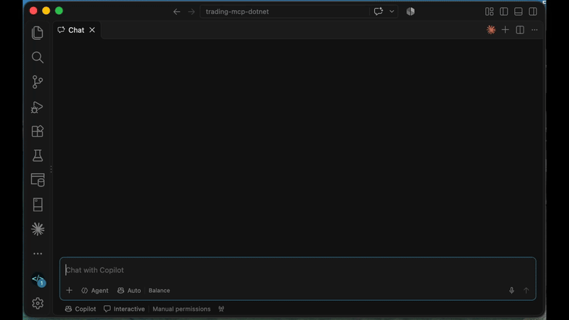
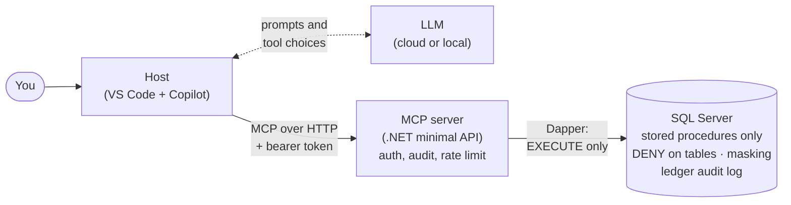

# Secure, read-only MCP server for SQL Server: a real-world example in C# and .NET

[](https://github.com/Code-Express-AI/trading-mcp-dotnet/actions/workflows/build.yml)

## Project purpose

This project uses MCP to connect AI assistants, such as GitHub Copilot or Claude, to an existing SQL Server database. The example we use is a fictional bank's stock trading system. The assistant can query the data but **can't change anything in the database**.



## What is MCP?

MCP (Model Context Protocol) is the open standard that lets AI assistants discover and call tools in your own systems. If you've built a web API, you already know most of it. The difference is who calls it: not code you wrote, but an AI assistant that reads each tool's description and decides for itself what to call. In .NET, turning a method into an MCP tool takes just one attribute: `[McpServerTool]`. Making it safe to point at a real database is the hard part, and that's what this project shows.

## What you'll learn

We'll show you how to:

- **Build a real MCP server, not hello world:** eight read-only tools that work together, descriptions that help the model pick the right tool, errors the model can act on, auditing, rate limiting and tests.
- **Lock it down in layers, so each security layer holds even if the one above fails:** token authentication, rate limits, fixed tools, stored-procedure-only database access, data masking, and an audit log that can't be changed, even by `sa`.

## Try it for free

Everything except the optional Azure deployment runs on your own machine. You'll need:

- [Git](https://git-scm.com/)
- [.NET 10 SDK](https://dotnet.microsoft.com/download)
- [Docker Desktop](https://www.docker.com/products/docker-desktop/) (on Windows, use the default WSL 2 backend)
- [VS Code](https://code.visualstudio.com/) with [GitHub Copilot](https://github.com/features/copilot) (the free tier is enough)
- [Node.js](https://nodejs.org/) (optional: only needed to test the server with MCP Inspector)
- An [Azure account](https://azure.microsoft.com/free/) (optional: only for the Azure deployment guide)

All of it is free for personal use. SQL Server runs in Docker as the free Developer edition, and the Azure deployment fits within Azure's free tiers for App Service and Azure SQL Database.

## Quick start

These commands work unchanged in PowerShell, macOS and Linux. After step 1, run everything from the repository root. For an explanation of each step, see the [step-by-step guides](#step-by-step-guides), which also cover troubleshooting.

**1. Get the code:**

```sh
git clone https://github.com/Code-Express-AI/trading-mcp-dotnet.git
cd trading-mcp-dotnet
```

**2. Create your settings.** Copy the example file, then change the two passwords and the token in `.env`. Open it in VS Code: files starting with a dot are hidden in Finder and Explorer.

```sh
cp .env.example .env
```

**3. Start the database and load the data:**

```sh
docker compose up -d --wait
docker compose run --rm db-init
dotnet run --project DataGenerator
```

**4. Run the MCP server.** It reads its settings from `.env`:

```sh
dotnet run --project McpServer
```

**5. Check it's running.** Open [http://localhost:5080/health](http://localhost:5080/health) in a browser. It should return `{"status":"ok"}`.

Next, test the tools with MCP Inspector in [guide 2](docs/02-run-server-and-inspector.md), or jump straight in and ask Copilot or Claude Code questions in [guide 3](docs/03-copilot-or-claude-code.md).

## Videos

| # | Video | Guide |
|---|-------|-------|
| 1 | Intro demo: Copilot answers questions from the database, but our security layers stop it deleting anything | – |
| 2 | Set up SQL Server in Docker, and the database security behind it | [Guide 1](docs/01-docker-database.md) |
| 3 | Test the server with MCP Inspector, then connect Copilot | [Guides 2](docs/02-run-server-and-inspector.md) and [3](docs/03-copilot-or-claude-code.md) |

Video links will be added as episodes are published. The guides for [deploying to Azure](docs/04-azure-deployment.md) and [running with a local model](docs/05-local-llm.md) are already here; videos for them may follow, depending on viewer demand.

## Architecture



Many MCP database examples give the model a tool that runs any SQL it writes. We don't: the model can only call eight fixed tools, each backed by a stored procedure. The model decides which tool to call; the host makes the call and returns the result. The security doesn't rely on the model behaving: even if it's tricked into asking for something it shouldn't, the server and the database refuse. If it makes too many calls in quick succession, a rate limit stops it.

- **Server:** ASP.NET Core minimal API and Dapper
- **Database:** SQL Server, accessed only through stored procedures
- **Authentication:** named bearer tokens locally, Microsoft Entra ID (formerly Azure Active Directory) in production
- **Secrets:** .NET user-secrets and the git-ignored `.env` file, never in source control

## The tools

| Tool | Example question |
|---|---|
| `get_dataset_info` | What data is there, and what's the latest price date? |
| `search_instruments` | Which pharma companies are listed? |
| `get_price_history` | How has Brightwater Pharma's share price moved this year? |
| `get_top_movers` | What were the biggest movers on the last trading day? |
| `find_accounts` | Find the accounts for a client called Thompson. |
| `list_trades` | What did that account trade last month? |
| `get_positions` | What does that account hold, and is it up or down? |
| `get_portfolio_summary` | Summarise that account's portfolio by sector. |

You ask in plain English, and the model picks the tools, often several for one question. For example, "Do any of Thompson's accounts hold yesterday's three biggest losers?" uses `find_accounts`, `get_top_movers` and `get_positions`. Our tools only return rows of data as JSON. The model combines them into the answer, as the demo at the top of this page shows.

Each tool is a few lines. Here's `find_accounts`, from [TradingTools.cs](McpServer/Tools/TradingTools.cs):

```csharp
[McpServerTool(Name = "find_accounts", ReadOnly = true)]
[Description("Finds client accounts by (part of) the client's name. Returns at most 25. " +
             "Account numbers are masked for privacy, so use the returned accountId in the other tools.")]
public Task<IReadOnlyList<Account>> FindAccounts(
    [Description("At least 2 characters of the client's name, e.g. 'Thompson'.")] string name,
    CancellationToken ct = default) =>
    audit.RunAsync("find_accounts", new { name }, () =>
    {
        ToolArguments.Require(name?.Trim().Length >= 2, "name must be at least 2 characters, for example 'Thompson'.");
        return repo.FindAccounts(name!, ct);
    });
```

- **`[Description]`** is written for the model, not for people. It's how the model knows when to call the tool, and what to do with the result.
- **`ToolArguments.Require`** rejects a bad argument with a message that tells the model how to fix it.
- **`audit.RunAsync`** records every call, including rejected ones.
- **`repo.FindAccounts`** calls one stored procedure. That's all the database lets the server do.

## Step-by-step guides

The detailed guides walk you through each step, explain why we built it that way, and cover testing, troubleshooting and the optional setups.

1. [Set up the database, and see how it's locked down](docs/01-docker-database.md)
2. [Run the MCP server and test it with MCP Inspector](docs/02-run-server-and-inspector.md)
3. [Connect Copilot or Claude Code, then ask questions](docs/03-copilot-or-claude-code.md)
4. Optional: [Deploy the database and MCP server to Azure](docs/04-azure-deployment.md)
5. Optional: [Use a local model](docs/05-local-llm.md)

## Tests

Unit tests need nothing installed. Integration tests run against the local Docker SQL Server and prove the security holds: the MCP login can't read or change the tables directly, and nobody, not even `sa`, can change the audit log. If SQL Server isn't running, they're skipped with the reason. GitHub Actions runs every test on every push, and there a missing database fails the build instead.

```sh
dotnet test XTests/XTests.csproj                                     # all tests
dotnet test XTests/XTests.csproj --filter 'Category!=Integration'   # unit tests only
dotnet test XTests/XTests.csproj --collect:"XPlat Code Coverage"     # with coverage
```

## Security design

Each layer grants only what's needed, and holds even if the one above it fails.

| Layer | Protection |
|---|---|
| Who can call | Named bearer tokens locally, [Microsoft Entra ID](docs/entra-setup.md) in production. Only the expected host names are accepted, which blocks DNS-rebinding attacks |
| How often | A rate limit for each caller |
| What they can ask | Eight fixed, read-only tools, with every argument checked |
| What the database allows | `EXECUTE` on the stored procedures and nothing else: `DENY` on every table, fixed columns, row limits, no dynamic SQL |
| What leaks | Account numbers and emails are masked, and unexpected database errors never reach the model, only a generic message |
| What's recorded | Every call, in an append-only ledger table that even `sa` can't change, and that SQL Server can verify hasn't been tampered with |

Before using this pattern with a real database, see [Before you go to production](docs/04-azure-deployment.md#before-you-go-to-production).

## Tested with

| Component | Version | Date checked |
|-----------|---------|--------------|
| .NET SDK | 10.0.x | 22-Oct-2026 |
| ModelContextProtocol.AspNetCore | 2.3.0 | 22-Oct-2026 |
| SQL Server container | 2022-latest | 22-Oct-2026 |
| Host / model | VS Code 1.143.1 / Copilot free tier, Auto model selection (Copilot picked gpt-6-luna) | 23-Oct-2026 |

The MCP SDK and its authorization support are changing quickly. If something doesn't work, check the [C# SDK's issues](https://github.com/modelcontextprotocol/csharp-sdk/issues) for known problems.

## Where to look in the code

- [TradingTools.cs](McpServer/Tools/TradingTools.cs): the eight tools, their descriptions and argument checks
- [03_procedures.sql](sql/03_procedures.sql): the stored procedures, the security boundary
- [02_security.sql](sql/02_security.sql): the read-only database user, with `DENY` on every table
- [AuditService.cs](McpServer/Audit/AuditService.cs): auditing, and errors written for the model
- [McpServerApplication.cs](McpServer/McpServerApplication.cs): the whole server, set up on one page
- [When_The_Mcp_Reader_Bypasses_The_Procedures.cs](XTests/Integration/When_The_Mcp_Reader_Bypasses_The_Procedures.cs) and [When_The_Audit_Log_Is_Tampered_With.cs](XTests/Integration/When_The_Audit_Log_Is_Tampered_With.cs): the tests that prove the database refuses

## Licence

MIT. See [LICENSE](LICENSE).

---

Made by Liam from [Code Express AI](https://codeexpress.ai). Check out my tutorials on [YouTube](https://www.youtube.com/@CodeExpressAI).
